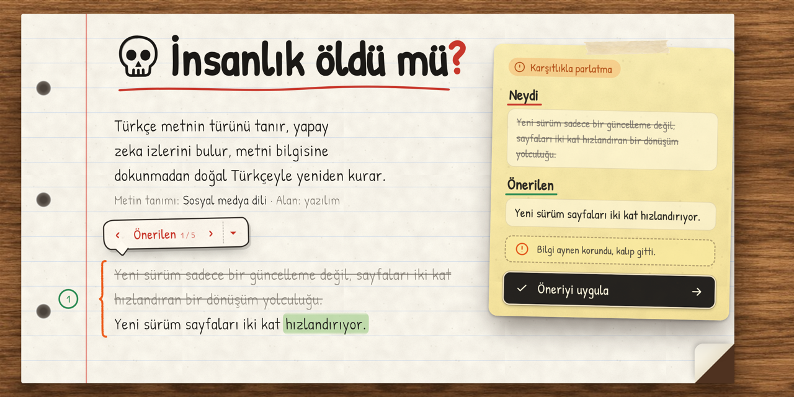
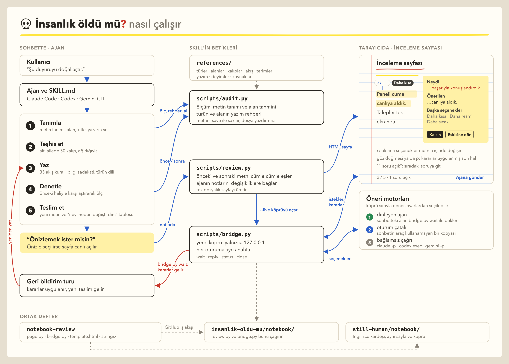
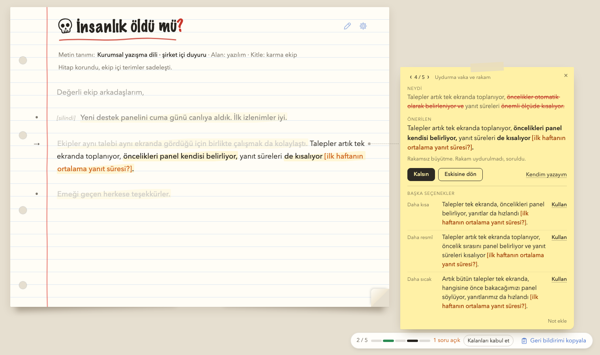

# İnsanlık öldü mü?



**İnsanlık öldü mü?** bir ajan skill'i. Türkçe bir metni yapay zeka yazmış gibi gösteren izleri bulur ve metni bir insanın yazacağı gibi yeniden kurar. Metindeki bilgiye dokunmaz, yalnızca anlatımı düzeltir. Claude Code, Codex, Gemini CLI ve Antigravity'de çalışır. Dosya okuyabilen her ajan da talimat dosyasını (`SKILL.md`) kullanabilir.

Yapay zekanın yazdığı bir metin çoğu zaman ilk cümlesinden belli olur:
- Söze "Hızla değişen dünyamızda" diye girer.
- Cümleler sırayla "-maktadır", "-mektedir" diye biter.
- Her özellik "yalnızca bir araç değil, bir deneyim" olur.
- Metin, kimsenin itiraz etmeyeceği parlak bir gelecek cümlesiyle kapanır.

## Bir örnek

**Önce** (şirket içi duyuru):

> Günümüzün hızla değişen dijital dünyasında müşteri memnuniyeti her zamankinden daha kritik bir öneme sahiptir. Bu doğrultuda yeni destek panelimizi geçtiğimiz cuma günü başarıyla konuşlandırdık — ve sonuçlar şimdiden umut verici!
>
> Yeni panel sadece bir araç değil, aynı zamanda ekiplerimiz arasındaki iş birliğini güçlendiren bir köprü. Talepler artık tek ekranda toplanıyor, öncelikler otomatik olarak belirleniyor ve yanıt süreleri önemli ölçüde kısalıyor.

**Sonra:**

> Yeni destek panelini cuma günü canlıya aldık. İlk izlenimler iyi.
>
> Talepler artık tek ekranda toplanıyor, öncelikleri panel kendisi belirliyor, yanıt süreleri de kısalıyor [ilk haftanın ortalama yanıt süresi?]. Ekipler aynı talebi aynı ekranda gördüğü için birlikte çalışmak da kolaylaştı.

Ne değişti:
- Klişe giriş ("Günümüzün hızla değişen dijital dünyasında") ve abartı ("kritik bir öneme sahiptir") çıktı.
- "Konuşlandırdık" yerine ekiplerin gerçekten kullandığı söz geldi: "canlıya aldık".
- Uzun tire ve "sadece X değil, aynı zamanda Y" kalıbı gitti.
- "Önemli ölçüde kısalıyor" iddiasının arkasında bir rakam yoktu. Skill rakam uydurmadı, köşeli parantez içinde sordu.

## Hızlı başlangıç

**1. Kur.** Terminale şunu yapıştır:

```bash
npx skills add MesutARIDORU/insanlik-oldu-mu -g -y -a claude-code codex gemini-cli
```

Bu komut skill'i Claude Code, Codex ve Gemini CLI'a soru sormadan kurar. Bilgisayarında Node.js ve Python 3 olmalı. Başka araçlara kurmak ya da listeden seçmek için [Kurulum](#kurulum) bölümüne bak.

**2. Metni ver.** Ajana metni yapıştır ve ne istediğini söyle:

```
Şu e-postayı doğallaştır:
[metin]
```

"Doğallaştır", "insanlaştır", "yapay zeka kokuyor" ya da "bunu yapay zeka mı yazmış?" demen yeter. Skill'i adıyla da çağırabilirsin:

| Araç | Komut |
|---|---|
| Claude Code | `/insanlik-oldu-mu [metin]` |
| Codex | `$insanlik-oldu-mu [metin]` |
| Gemini CLI | `/insanlik-oldu-mu [metin]` |

**3. Sonucu al.** Skill çalışmaya başlayınca sohbette önce şu satır görünür:

> 💀 **İnsanlık öldü mü❓** · Metin tanımı: kurumsal yazışma dili (e-posta) · Alan: finans · Yaklaşım: tam yeniden yazım, selamlama ve kapanış korunur

Baştaki kuru kafa ve sondaki kırmızı soru işareti skill'in logosu. Bu satırı görüyorsan skill devrede demektir. Satırdaki metin tanımı, inceleme sayfasında da başlığın altında yazar.

Ardından yeniden yazılmış metin ve "Neyi neden değiştirdim" tablosu gelir. Değişikliklere tek tek bakmak istersen [inceleme sayfası](#inceleme-sayfası) açılır. Sayfayı sonradan görmek için sohbete "önizle" yazman yeter.

## Nasıl çalışıyor

Skill, ajana her metinde aynı beş adımı izletir:

1. **Tanır ve ölçer.** Metnin türünü (e-posta, şartname, öykü…) ve alanını (finans, sağlık, yazılım…) belirler. Ölçümü ve o türün yazım rehberini `scripts/audit.py` verir.
2. **Teşhis eder.** Metindeki izler kodlu kalıp kataloğuna göre işaretlenir. Bazısı tek başına yeter, bazısı ancak bir arada görününce iz sayılır.
3. **Yeniden yazar.** Önce cümlelerin kuruluşu, sonra kelimeler düzelir.
4. **Denetler.** Yeni metin yeniden ölçülür ve eski haliyle karşılaştırılır.
5. **Teslim eder.** Sohbete yeni metin, değişiklik tablosu ve ölçüm sonuçları gelir. İstersen ardından inceleme sayfası açılır.

Talimatların hepsi `SKILL.md` dosyasında, rehberler `references/` klasöründe. İnceleme sayfasını `scripts/review.py` üretir. `scripts/bridge.py` de sayfayla ajan arasında yalnız senin bilgisayarında çalışan bir köprü kurar. Sayfadan gelen öneri istekleri ve kararlar bu köprüden geçer. Kararlar geri bildirim turunda metne işlenir.



`scripts/audit.py` dedektörlerin ölçtüğü şeyleri sayar. Teslimde her birinin önceki ve sonraki değeri yan yana durur:
- cümle boylarının ne kadar çeşitli olduğu,
- cümlelerin aynı kelimeyle açılıp açılmadığı,
- cümle sonlarının aynı ekle bitip bitmediği,
- uzun tire,
- "değil" ve "asıl" sıklığı,
- yapay zekanın ve moda dilin sık kullandığı sözler,
- plaza jargonu,
- İngilizceden kelimesi kelimesine çevrilmiş e-posta kalıpları,
- Ateşman okunabilirlik puanı.

## Neye dikkat ediyor

### Metne bilgi eklemez

Yapay zeka metinlerini "insanlaştıran" araçların çoğu, metni daha inandırıcı göstermek için olmayan şeyler ekler: bir yüzde, bir kurum adı, yaşanmamış bir anı. Metni kullanan kişi bunu fark etmeden yayımlar ve yanlış bilgi yayılır.

İnsanlık öldü mü? metinde olmayan hiçbir bilgiyi eklemez. Bir cümle somut bir bilgi istiyorsa şunlardan birini yapar:
- Metinde zaten olan bir bilgiyi öne çıkarır.
- Eksik bilgiyi köşeli parantezle işaretler: `[ilk haftanın ortalama yanıt süresi?]`.
- Sana sorar.

### Metnin türüne göre yazar

Şiirde dizenin nerede kırılacağına şair karar verir. Teknik şartnamede "-malıdır" bir zorunluluk bildirir. Kurumsal bir e-postanın sonundaki "Saygılarımla" nezaket gereği oradadır. Bunları yapay zeka izi sanıp düzeltmek metni bozar.

Bu yüzden skill önce metnin türünü belirler, sonra o türün diliyle yazar. Tanıdığı türler:
- şiir ve edebi anlatı,
- deneme ve kişisel yazı,
- kurumsal yazışma,
- teknik şartname ve teknik doküman,
- akademik, hukuki ve haber dili,
- pazarlama ve sosyal medya.

Şiiri kendiliğinden yeniden yazmaz, yalnızca izleri gösterir. Şartnamede ölçülemeyen sıfatları ayıklar, "-malıdır"a dokunmaz. E-postada selamlama kalır, konuya gelmeyen giriş gider.

Alanlar için de ayrı notlar var: yazılım, finans, sağlık, eğitim, hukuk, kamu, e-ticaret, insan kaynakları ve pazarlama. Her not metni kimin okuduğunu, hangi terimlerin kalacağını ve değişirse zarar verecek bilgileri söyler. Bankanın e-postasındaki oran ve tarih, hastanenin bilgilendirmesindeki doz ve süre, sözleşmedeki madde numarası olduğu gibi kalır.

### Önce cümlenin kuruluşunu düzeltir

Hangi kelimelerin "yapay zeka kokduğu" her yeni modelle değişiyor. Cümlelerin kuruluşundaki izler ise kalıyor:
- aynı boyda cümleler,
- aynı ekle biten yüklemler,
- "X değil, Y" kalıbı,
- her şeyi üçe bölme alışkanlığı.

Kelimeleri eşanlamlılarıyla değiştirmek bu izleri silmez. Skill önce cümlelerin kuruluşunu değiştirir, sonra boşalan yeri Türkçenin kendi araçlarıyla doldurur: virgülle birbirine bağlanan eylemler, ikilemeler, "-miş"li anlatım, cümlenin sonuna kayan bağlaçlar.

### Her değişikliği gerekçesiyle gösterir

Yeni metinle birlikte bir tablo gelir: eski hali, yeni hali ve neden değiştiği. Gerekçeler 50 kalıplık kodlu bir katalogdan gelir, bu yüzden her metinde aynı ölçüyle verilir.

### Sağlam metni bozmaz

- **İyi yazılmış metin:** Akademik metindeki "-maktadır" orada doğru üsluptur. Editörden geçmiş temiz bir yazı da yapay zeka sayılmaz. Skill tek tek kelimelere bakmaz, izlerin bir arada görünmesine bakar.
- **Dokunulmayanlar:** Alıntılar, özel adlar, kod, ürün adları ve arayüz etiketleri.
- **Diyalog çizgisi:** Romanda satır başındaki konuşma çizgisi TDK'nin tanımladığı bir işarettir, silinmez.
- **İnsan izleri:** Tuhaf ama özgül ayrıntılar, karışık duygular, devrik cümleler ve noktalamaya yansıyan duygu görünce skill metne daha az dokunur.

## İnceleme sayfası

Değişikliklere tek tek bakıp her birine karar vermek istersen skill bir inceleme sayfası açar. Sayfa, ahşap bir masada duran bir defter yaprağına benzer.



### Ne zaman açılır

Metin ve tablo her durumda önce sohbete gelir, sayfa için seni bekletmez. Skill'i ilk kullandığında sayfa kendiliğinden açılır ve sayfadaki bir not bundan sonra ne olacağını sorar:

| Seçim | Ne olur |
|---|---|
| Her seferinde aç | Sayfa her yeniden yazımdan sonra açılır. |
| Önce bana sor | Skill sohbette "Değişiklikleri önizleme sayfasında görmek ister misin?" diye sorar. Metin uzunsa ya da değişiklik çoksa sormadan açar. |
| Ben isteyince aç | Sayfa kendiliğinden açılmaz. Sohbete "önizle", "sayfada göster" ya da "değişiklikleri sayfada aç" yazınca açılır. Bu seçimden sonra not, yazabileceğin bu cümleleri küçük bir yazma animasyonuyla gösterir. |

Claude Code soruyu tıklanabilir seçeneklerle sorar. Codex'te ve Gemini CLI'da cevabı yazman yeterli.

Seçimini istediğin zaman değiştirebilirsin: sayfanın ayarlarındaki Önizleme satırından ya da sohbette "önizleme hep açılsın" gibi bir cümleyle. Yalnız o sohbet için "bu sohbette hep aç" ya da "bu sohbette açma" da diyebilirsin. Seçim `~/.config/insanlik-oldu-mu/preferences.json` dosyasında saklanır.

### Sayfada ne yaparsın

- **Değişiklikleri görürsün.** Değişen kelimelerin arkasında yeşil bir fosforlu kalem izi var. Silinen yerde küçük bir "[silindi]" notu durur. Onayladığın bir değişikliğin eski hali, üstü çizili olarak yeni halin hemen üstünde kalır.
- **Bir cümleye tıklarsın.** Bantlı bir not kartı açılır. Kartta üç bölüm var:
  - **Neydi:** cümlenin eski hali, üstü çizili.
  - **Önerilen:** yeni hali ve altında gerekçesi.
  - **Başka seçenekler:** aynı cümlenin daha kısa, daha resmî ve daha sıcak hali.
- **Karar verirsin.** "Öneriyi uygula" değişikliği onaylar ve sıradakine geçer. "Kalsın" eski hali bırakır. "Kendim düzenleyeyim" cümleyi senin yazmana açar. Başka bir seçeneği yanındaki okla alırsın. Klavyede 1, 2 ve 3 tuşları da aynı işi görür.
- **Son hali okursun.** Başlığın yanındaki göz düğmesi ya da `p` tuşu, kararların uygulanmış halini işaretsiz gösterir.

<details>
<summary>Sayfanın öbür ayrıntıları</summary>

- Kenarda her değişikliğin numaralı bir yuvarlağı var. Birden çok satıra yayılan bir değişikliği turuncu bir küme parantezi sarar, gerekçesinin ilk cümlesi sağ kenarda kısa bir not olarak durur.
- Kartın üstündeki oklarla değişiklikler arasında gezersin.
- Geniş ekranda kart defterin sağında, üst hizada açılır ve sayfa kayarken yerinde kalır. İnce kesik bir çizgi kartı cümleye bağlar. Ajanın içindeki tarayıcı gibi dar bir pencerede kart cümlenin altında, telefonda ekranın altında açılır.
- Kâğıdın son satırı kaç değişikliği onayladığını gösterir. Köşeli parantezle sorulan bilgiler turuncu yazılır ve sayılır. "1 soru açık" yazısına tıklayınca sıradaki soruya gidersin.
- Değişen bir kısmın üstüne gelince el çizimi bir balon açılır ve metinde duran seçeneğin adını gösterir. ‹ › oklarıyla önerilen hal, daha kısa, daha resmî, daha sıcak ve eski hal arasında metnin içinde gezersin. ▾ ile hepsini liste halinde görüp birini seçersin. Son hal görünümünde de aynı balon çıkar.

</details>

### Sayfa ajanla konuşur

Sayfa canlı açıldığında ajana bağlıdır:
- Kartın altındaki kutuya "daha samimi" ya da "deyimle söyle" gibi bir istek yazarsan ajan iki üç seçenek daha getirir.
- "Ajana gönder" düğmesi kararlarını sohbete yollar. Kopyalayıp yapıştırman gerekmez.

Öneriler üç yoldan gelebilir. Hangisinin kullanılacağını sayfanın ayarlarından seçersin:
- sohbetteki ajanın kendisi,
- sohbetin bağlamını bilen bir kopyası,
- sohbet geçmişini bilmeyen, hızlı bir çağrı.

Sayfa ve köprü, İngilizce kardeşi [Still Human?](https://github.com/MesutARIDORU/still-human) ile ortak. İkisi de [notebook-review](https://github.com/MesutARIDORU/notebook-review) deposundan gelir ve skill'in `notebook/` klasörüne kopyalanır. Sayfada yapılan bir düzeltme böylece iki skill'e birden ulaşır. Sayfanın Türkçe metinleri `notebook/strings/tr.json` dosyasında.

## Hangi araçlarda çalışır

| Araç | Durum | Kurulum |
|---|---|---|
| Claude Code (terminalde ve Claude masaüstü uygulamasının Code sekmesinde) | Çalışıyor | `npx skills` |
| Codex CLI | Çalışıyor | `npx skills` |
| ChatGPT masaüstü uygulamasındaki Codex | Skill'i görüyor | `npx skills`, Codex CLI ile aynı klasörü okur |
| Antigravity | Ayar betiğiyle | `npx skills`, ardından ayar betiği: `--targets antigravity` |
| Gemini CLI | Skill'i görüyor, hesap gerekiyor | `npx skills`. Google bu aracı ücretsiz bireysel hesaplarda kapattı |
| Claude masaüstü ve web sohbeti | ZIP ile, denenmedi | Sürüm sayfasındaki ZIP'i Customize > Skills'ten yükle |

23 Ekim 2026'da şu sürümlerle denendi: Claude Code 2.1.300, Codex CLI 0.162.1, ChatGPT 26.1016 içindeki Codex 0.163.0-alpha ve Gemini CLI 0.60.0. Codex CLI, bilgisayarda yüklü 230 skill arasından bu skill'i adı verilmeden seçti. Seçmezse isteğinin başına `$insanlik-oldu-mu` yaz. Her aracın ayrıntıları ve sınırları [INSTALL.md](INSTALL.md#araçlara-göre-notlar) dosyasında.

## Kurulum

Gerekenler: Node.js (`npx` için) ve Python 3.8 ya da daha yenisi. Betikler yalnız Python'un standart kütüphanesini kullanır, ek paket kurulmaz.

Kurulumu `npx skills` yapar. Skill, ortak `~/.agents/skills` klasörüne tek kopya olarak iner ve `~/.agents/.skill-lock.json` kilit dosyasına yazılır. Codex ve Gemini CLI skill'i bu klasörden okur, Claude Code'a da bu klasöre giden bir bağlantı kurulur. Öbür skill'lerin de bu yolla kuruluysa hepsi aynı yerde durur.

### Tek komutla

```bash
npx skills add MesutARIDORU/insanlik-oldu-mu -g -y -a claude-code codex gemini-cli
```

Komut soru sormaz. Sonunda şu özeti görürsün:

```
◇  Installed 1 skill
│  ✓ ~/.agents/skills/insanlik-oldu-mu
│    universal: Codex, Gemini CLI
│    symlinked: Claude Code
```

### Listeden seçerek

```bash
npx skills add MesutARIDORU/insanlik-oldu-mu -g
```

Komut sırayla üç şey sorar:

1. **Which agents do you want to install to?** Listenin üstündeki "Universal" bölümünde Codex, Gemini CLI ve ortak klasörü okuyan öbür ajanlar var. Bunlar her zaman kurulur, seçmen gerekmez. **Claude Code bu bölümde yok ve seçili gelmez.** Alttaki "Search" alanına `claude` yaz, Claude Code'u boşluk tuşuyla işaretle ve Enter'a bas. Bunu atlarsan skill Claude Code'a kurulmaz.
2. **Installation method:** Yalnızca ek bir ajan seçtiysen sorulur. "Symlink (Recommended)" seçili gelir, Enter'a bas.
3. **Proceed with installation?** Önce kurulumun özetini ve skill'in güvenlik taramasını gösterir. "Yes" seçili gelir, Enter'a bas.

### İsteğe bağlı ayarlar

Kurulum burada biter, skill kullanıma hazır. Aşağıdakileri de istersen kurulan kopyadaki ayar betiği yapar:
- **Claude Code:** Skill ve betikleri her seferinde onay sormadan çalışsın diye izin ekler. Önce ayar dosyanın yedeğini alır.
- **Codex:** Çok sayıda skill yüklüyse Codex bu skill'i kendiliğinden seçmeyebilir. Betik, Codex'in genel talimatlarına üç satırlık bir yönlendirme notu ekler.
- **Gemini CLI:** `/insanlik-oldu-mu` komutunu ekler.
- **Antigravity:** Skill'i Antigravity'nin klasörüne (`~/.gemini/config/skills`) bağlar. `npx skills` bunu yapmaz, bu yüzden Antigravity kullanıyorsan bu adım gerekli. Yoksa skill orada görünmez.

```bash
python3 ~/.agents/skills/insanlik-oldu-mu/scripts/install.py
```

Betik skill'i yeniden kurmaz. Her ayardan önce ayrıca sorar ve onay vermediğin hiçbir dosyaya dokunmaz. Betiğin seçenekleri ve Node.js olmadan kurulum [INSTALL.md](INSTALL.md) dosyasında.

### Kurulduğunu nasıl anlarım?

Ajana Türkçe bir metin ver ve "doğallaştır" de. Skill devreye girdiyse sohbette ilk olarak logolu satır görünür:

> 💀 **İnsanlık öldü mü❓** · Metin tanımı: kurumsal yazışma dili (e-posta) · Alan: finans · Yaklaşım: …

| Araç | Skill'i kendiliğinden seçer mi | Adıyla çağırmak için |
|---|---|---|
| Claude Code | Evet | `/insanlik-oldu-mu` |
| Codex | Ayar betiğinin yönlendirme notu varsa evet. Not yoksa ve çok sayıda skill yüklüyse seçmeyebilir | `$insanlik-oldu-mu` |
| Gemini CLI | Skill'i ortak klasörden okur, kendiliğinden seçip seçmediği denenmedi | `/insanlik-oldu-mu` (ayar betiği ekler) |

### Güncelleme ve kaldırma

Güncellemek için:

```bash
npx skills update -g insanlik-oldu-mu
```

Kaldırmak için:

```bash
npx skills remove insanlik-oldu-mu -g
```

Ayar betiğinin eklediği izinleri ve notu silmek ve AGENTS.md okuyan öbür araçlara elle kurmak için [INSTALL.md](INSTALL.md) dosyasına bak.

## Kullanım

Ajana metni ver ve ne istediğini söyle:

```
Şu LinkedIn gönderisini doğallaştır, okurlar genel kitle:
[metin]
```

| Ne istiyorsun | Şöyle de |
|---|---|
| Metni baştan kurması (tam yeniden yazım) | "doğallaştır", "insanlaştır", "akıcı yap" |
| Az dokunması (hafif dokunuş) | "çok değiştirme, sadece düzelt" |
| Yalnızca değerlendirmesi (teşhis) | "bunu yapay zeka mı yazmış?", "puanla ama değiştirme" |
| Sıfırdan yazması (sıfırdan yazım) | "doğal bir Türkçeyle şu duyuruyu yaz" |
| Senin sesinle yazması | Kendi yazından iki üç paragraf ekle. Skill cümle boyunu, üslubu, okura nasıl hitap ettiğini ve kelime seçimini ondan alır. Örnekteki bilgileri metne taşımaz |

## Teknoloji jargonu

Kelime seçiminde ölçü, okurun gerçekten kullandığı dil. Karar kitleye göre verilir:
- **Geliştirici ekibine giden metin:** "deploy", "PR", "deadline" kalır. "Konuşlandırma" ya da "çekme isteği" gibi kimsenin kullanmadığı çeviriler iz sayılır.
- **Genel okura giden metin:** "Canlıya almak" ve "teslim tarihi" tercih edilir. "Süre sonu" gibi tutmamış karşılıklar önerilmez.
- **Her metinde:** Ürünün ne yaptığını söylemeden metni "teknolojik" gösteren sözler iz sayılır: dijital dönüşüm, uçtan uca, ölçeklenebilir, sorunsuz entegrasyon.

## Nereden besleniyor

- **TDK'nin yazım kuralları:** Noktalama, düzeltme işareti, uzun çizgi, büyük harf, sayılar, kısaltmalar ve pekiştirmeli sözler sayfaları tek tek okundu.
- **TDK Güncel Türkçe Sözlük:** Deyimlerin sözlükte ayrı madde olarak geçip geçmediği tek tek işaretlendi. Akış kurallarındaki bazı örnekler, sözlükte geçen ve telif süresi dolmuş yazarlara ait gerçek cümleler.
- **Ateşman okunabilirlik formülü:** `audit.py` içindeki okunabilirlik puanının dayanağı.
- **Kullanım:** Jargon kararlarında ölçü, okurun gerçekte kullandığı dil. Örneğin "süre sonu" kulağa yapay geldiği için "deadline" yerine önerilmiyor.
- **Alan notları:** Dokuz alanın okurları, terimleri ve hassas bilgileri `references/sectors.md` ve `references/jargon.md` dosyalarında.
- **Kendi deneme setimiz:** `evals/` altında altı örnek metin ve her biri için beklenen davranış.

Ayrıntılı kaynak listesi [references/sources.md](references/sources.md) dosyasında.

## English summary

*İnsanlık öldü mü?* ("Is humanity dead?") is an agent skill for Turkish text. It finds the marks that make a text read as machine-written and rewrites it without adding facts that were not in the source.
- **Patterns:** It detects 50 coded patterns, from "-maktadır" rhyme and "not X but Y" scaffolding to buzzwords, over-translated tech terms and fabricated sources.
- **Flow:** 35 rules built on Turkish grammar (word order, mood and certainty, reduplication, address) guide the rewrite.
- **Sectors:** Guides for nine fields (software, finance, health, education, law, public sector, e-commerce, HR, marketing) say who reads the text, which terms stay and which facts must never change.
- **Delivery:** Every rewrite comes with a change table and a numeric audit.
- **Review page:** An optional page, a notebook sheet on a wooden desk, marks the changed words with a green highlighter and keeps each approved original struck through above the new text. For each change the user can apply the suggestion, keep the original, pick another version, edit it or ask the agent for alternatives.
- **Live bridge:** A local bridge connects the page to Claude Code, Codex or Gemini CLI, either through the listening agent, a forked session or a stateless call.
- **Shared kit:** The page and the bridge come from [notebook-review](https://github.com/MesutARIDORU/notebook-review), which the English skill [Still Human?](https://github.com/MesutARIDORU/still-human) uses too. A copy lives in `notebook/` and is synced daily.

Works in Claude Code, Codex (CLI and the ChatGPT desktop app), Antigravity and Gemini CLI; Claude's desktop and web chat take the zip attached to each release. Install for Claude Code, Codex and Gemini CLI with `npx skills add MesutARIDORU/insanlik-oldu-mu -g -y -a claude-code codex gemini-cli`. In the interactive `npx skills add MesutARIDORU/insanlik-oldu-mu -g`, Codex and Gemini CLI are always included but Claude Code has to be selected by hand. Antigravity is left out by npx skills; the setup script links it (`--targets antigravity`). Optional settings (Claude Code permissions, Codex routing note, Gemini command, Antigravity link): `python3 ~/.agents/skills/insanlik-oldu-mu/scripts/install.py`.

## Lisans

MIT. Telif © 2026 MesutARIDORU. Ayrıntı [LICENSE](LICENSE) dosyasında.
